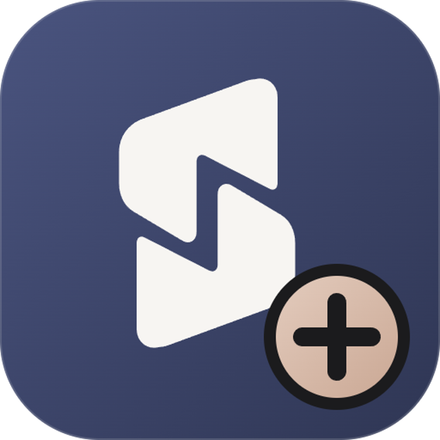
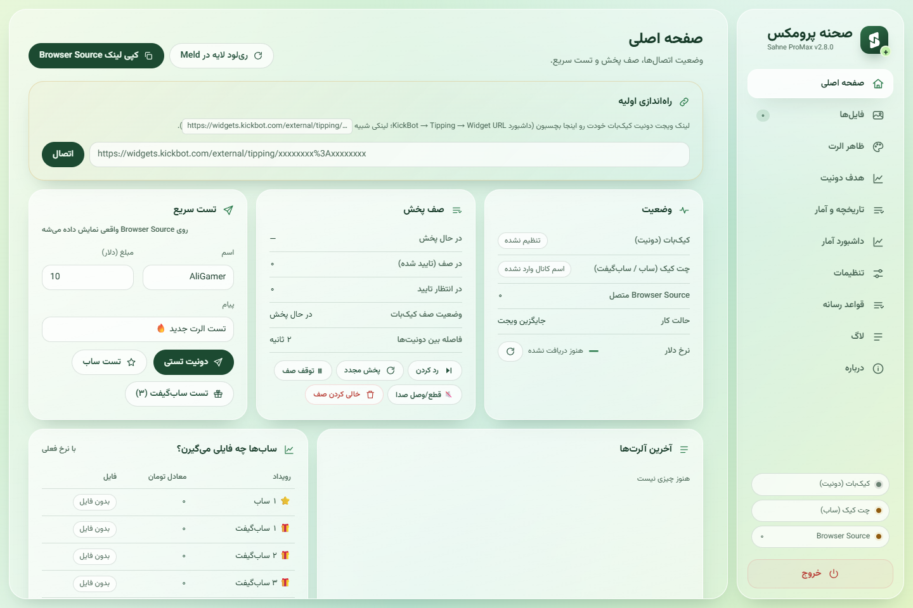

<div align="center">



# Sahne ProMax

### Your stream. Your alerts. Your machine.

A local-first alert studio for Kick creators.<br />
Connect your providers, build your alert library, and bring live widgets into OBS or Meld.

<p>
  <a href="https://github.com/B3hnamR/sahne-promax/releases/latest"></a>
  <a href="docs/README-FA.md"></a>
</p>

[](https://github.com/B3hnamR/sahne-promax/releases/latest)
[](package.json)
[](https://github.com/AmirEyZed/sahne-plus/tree/v1.6.1)
[](https://nodejs.org/)
[](#architecture)
[](LICENSE)

[Get Started](#quick-start) · [Features](#features) · [ProMax vs Plus](#promax-vs-sahne-plus) · [Develop](#development) · [Privacy](#privacy-and-safety)

</div>

> **2.8.0 · Sahne+ 1.6.1 integration.** This version brings the Mint controller, Kick connection recovery, optional Donofa goal/timer bridge and integration fixes to ProMax. Read the [2.8.0 release notes](docs/releases/RELEASE_NOTES_2.8.0.md) for changes and upgrade guidance. [Download the Windows installer](https://github.com/B3hnamR/sahne-promax/releases/tag/v2.8.0) or use the in-app updater; a source push alone does not update an installed app.

<p align="center">
  
  <br />
  <sub>Current main-branch controller, captured with a clean offline profile. No connected accounts or fabricated live events.</sub>
</p>

## At a Glance

**Sahne ProMax** is an independent fork of [Sahne Plus](https://github.com/AmirEyZed/sahne-plus) for Windows. A Persian-first desktop controller manages local media, provider connections, playback and widgets. OBS and Meld display the results through local Browser Sources.

| Connect                                       | Create                                                                  | Go live                                                                       |
| --------------------------------------------- | ----------------------------------------------------------------------- | ----------------------------------------------------------------------------- |
| KickBot, StreamElements, Donofa and Kick chat | Video, image and audio alerts; paired tracks; templates; scene profiles | A recoverable alert queue, live goal, top-donors widget and hardware controls |

There is no ProMax cloud backend or ProMax account to create. Media, configuration and history stay on your computer; enabled integrations connect directly to their providers. The server has no runtime npm dependencies. Electron and build tools are development dependencies, not an absence of a desktop runtime.

## Quick Start

### Install and Connect

1. Download the [Windows x64 installer](https://github.com/B3hnamR/sahne-promax/releases/latest). Windows 10 or 11 is required; Node.js is not needed for the installed app.
2. Connect a provider in Settings: a KickBot widget URL, StreamElements JWT, or Donofa API key. Configure your Kick channel for subscriptions, gifts and chat commands.
3. Add media in Files, set amount ranges or routing rules, and adjust the alert card in Appearance.
4. Add the Browser Sources below to OBS or Meld, then send a test alert from Home.

The installer is not Authenticode-signed, so Windows SmartScreen may warn. Download only from this fork's releases and compare the installer with the accompanying `SHA256SUMS.txt`.

### Browser Sources

| Source                          | Default URL                                      | Suggested canvas                                |
| ------------------------------- | ------------------------------------------------ | ----------------------------------------------- |
| Alert overlay                   | `http://localhost:7788/overlay`                  | 1920 × 1080                                     |
| Scene-specific alert appearance | `http://localhost:7788/overlay?profile=gameplay` | 1920 × 1080                                     |
| Local goal                      | `http://localhost:7788/goal`                     | 640 × 170; allow more height for timer/counters |
| Top donors                      | `http://localhost:7788/top?range=all&limit=5`    | 420 × 240                                       |

Use the URL shown by the app if your port differs. Create the named appearance profile before using its query parameter. Top-donor ranges are `daily`, `weekly` and `all`, with a limit from 1 to 20.

In widget-replacement mode, playback waits when no alert Browser Source is connected; goal/top widgets and controller previews do not count. A hidden source left connected can still consume alerts off-screen. Shutting hidden sources down permits waiting only when no other alert source or overlay browser tab remains connected.

Every active alert overlay receives the same event. Profiles change appearance, not the shared queue or event routing; the first matching completion acknowledgement advances that queue. Switching scenes, unloading or refreshing a source during playback can cut the current alert, and a newly connected overlay does not automatically replay it. Restart recovery retains up to 500 eligible waiting paid alerts, not already-started media, commands or tests.

### Choose the Right KickBot Mode

| Mode               | Use it when                                                                                              |
| ------------------ | -------------------------------------------------------------------------------------------------------- |
| Widget replacement | ProMax replaces the original KickBot widget and sends capture acknowledgements for accepted tips.        |
| Alongside widget   | The original KickBot widget remains responsible for capture; ProMax acts as the companion alert display. |

These modes govern KickBot behavior, not separate payment processing by ProMax. Test your chosen setup before streaming.

## Features

### Build Your Alert Library

- **Mixed media:** import MP4, WebM, MOV, MKV, PNG, JPEG, GIF, WebP, MP3, WAV, OGG and M4A. Playback still depends on Chromium codec support; use WebM for transparent video.
- **Paired audio:** attach an uploaded audio track to an image alert without encoding a new video.
- **Matching and routing:** use toman ranges, keywords, subscription-month/gift-count tiers, or ordered rules for source, event type, currency, amount and message. The simulator explains the selected media.
- **Appearance profiles:** give OBS scenes their own card position, typography and styling through profile-specific URLs.
- **Playback control:** configure volume, card delay and per-file duration. Video and audio can finish naturally, subject to configured cuts and a one-hour safety limit.

### Run the Live Show

- **Recoverable queue:** waiting alerts survive restart; sub/gift alerts receive priority while preserving order within each class. Manual replays go to the front.
- **Kick commands:** map `!commands` to media, with viewer/global cooldowns, rate limits and a command queue cap.
- **Local goal:** show progress, an optional deadline, subscription/gift counters and configurable milestone confetti.
- **Top donors:** add a separate live leaderboard Browser Source.
- **Local history and analytics:** inspect trends, donors, sources, currencies and playback results. Detailed history retains the newest 20,000 entries; aggregate totals are maintained separately.
- **Recording choice:** turn off history recording to stop saving new detailed events. Live totals continue in memory until restart. This does not disable logs, waiting-alert recovery or the bridge's operational journal.
- **External controls:** trigger skip, replay, queue pause/resume, mute, volume and clear through the local API.

### Keep Connections Manageable

- **Exchange rates:** Nobitex USDT/IRT supplies the primary USD-to-toman quote; Baha24 supplies fallback USD and supported non-USD quotes. Manual rates are available. Unsupported currencies are not assigned invented conversions.
- **Proxy routing:** supported HTTP requests can use a configured proxy or the Windows system proxy. This does not route every provider WebSocket through that proxy; see [network flows](docs/DATA_FLOW.md).
- **Kick chat recovery:** the current source validates cached/new/legacy Pusher keys and can discover replacement realtime credentials after key rejection.
- **Safer settings:** the current source reports failed manual saves without pretending they succeeded, and preserves relevant live settings and editable drafts.
- **Updates:** persistent sidebar/About actions in current source use this fork's releases. Installed Windows builds verify the installer against release checksums before running it, after user confirmation.
- **Portable backups:** export settings, media and saved history as ZIP. Provider/proxy secrets are omitted; reconnect providers after restore. Limits are 512 MiB per entry, 1 GiB per archive and 1,000 entries. Media absent from the archive is preserved.

## Providers and Donofa

| Source                           | Incoming alert in ProMax                       | Optional outbound Donofa bridge                    |
| -------------------------------- | ---------------------------------------------- | -------------------------------------------------- |
| KickBot                          | Tips, with mode-dependent capture behavior     | Confirmed tips                                     |
| StreamElements                   | Tips, with original currency retained          | Normalized paid tips                               |
| Donofa                           | Paid toman donations and matching optional TTS | Never forwards Donofa's own donations              |
| Kick subscriptions / gifts       | Subscription and gift alerts                   | Real subs/gifts, independently of alert visibility |
| Kick KICKs                       | No separate overlay alert                      | Upstream store value of USD 0.0105 per KICK        |
| Chat commands, tests and replays | Local playback where applicable                | Excluded                                           |

### Three Separate Goal-Related Features

| Feature                  | Direction                             | Setup                                                                                     |
| ------------------------ | ------------------------------------- | ----------------------------------------------------------------------------------------- |
| Donofa donation listener | Donofa → ProMax alerts                | Connect an API key and choose `.ir` or `.com` in Settings.                                |
| ProMax local goal widget | ProMax → local `/goal` Browser Source | Configure the Goal page and add its local URL to OBS.                                     |
| Donofa external bridge   | External supports → Donofa goal/timer | Configure the goal/timer on Donofa, then explicitly enable the bridge switches in ProMax. |

The external bridge is new in **2.8.0**. Its goal and timer switches **default off**, including for existing Donofa users. Disable Donofa's own Kick-sub counting before using ProMax for that accounting, or subscriptions may be counted twice. Bridge subscription valuation uses USD 4.99 per subscription, independently of the local alert's configurable toman display value.

Bridge state is account-bound and journaled locally. Delayed supports cannot be forwarded to a replacement account, and failed repair/persistence blocks unsafe account changes. The journal is not included in portable backups.

**The bridge is not an exactly-once service.** An ambiguous timer response is treated as sent to avoid doubling it, which can undercount. Concurrent donations during goal updates also retain a race. Live donation/TTS delivery and external goal/timer writes need verification with a real Donofa account before production use.

## ProMax vs Sahne Plus

Current ProMax source incorporates upstream changes through [Sahne+ 1.6.1](https://github.com/AmirEyZed/sahne-plus/tree/v1.6.1). Shared capabilities are credited as upstream features, not presented as ProMax inventions.

| Area                   | Shared with Sahne+ 1.6.1                                                                            | ProMax additions or adaptations                                                                                             |
| ---------------------- | --------------------------------------------------------------------------------------------------- | --------------------------------------------------------------------------------------------------------------------------- |
| Controller             | Mint visual direction, Vazirmatn, Persian counters, update discovery and accessibility improvements | Ten-page controller, custom dropdowns, native confirmation dialogs and feature-specific editors                             |
| Incoming supports      | KickBot, StreamElements, Kick subscriptions and gifts                                               | Donofa donation/TTS listener; integration with local widgets and routing                                                    |
| Donofa external bridge | Goal/timer support accounting, including KICKs                                                      | Explicit opt-in defaults, independent inbound listener, account-bound delayed alerts and stricter recovery/restore handling |
| Alert playback         | Waiting-alert recovery, long media and card delay                                                   | Sub-first scheduling, paired audio, subscription tiers and media-routing simulator                                          |
| History and analytics  | Both provide local history/analytics and a recording switch                                         | ProMax's own ledger, local `/goal` and `/top` widgets, timed goals, counters and milestone effects                          |
| Viewer interaction     | Kick realtime chat connection                                                                       | Free chat-to-media commands with rate limits                                                                                |
| Operations             | Local controller and OBS/Meld integration                                                           | Scene appearance profiles, dedicated hardware-control endpoints and portable ZIP backups                                    |
| Conversion             | Toman-based matching and currency display                                                           | Nobitex-first USD/Baha24 rate architecture retained; no Bonbast requests                                                    |
| Maintenance            | Kick realtime-key recovery, failure-aware manual saves and visible update actions                   | Modular backend/frontend, fork-specific updater identity and additional regression fixes                                    |

### Is the UI/UX Identical?

**No. The visual foundation is shared; the complete interface and motion are not identical.**

| Interaction                 | Sahne+ 1.6.1                                                    | Current ProMax                                                                         |
| --------------------------- | --------------------------------------------------------------- | -------------------------------------------------------------------------------------- |
| Color and typography        | Mint stage palette and Vazirmatn                                | Adapted Mint palette and Vazirmatn across ProMax pages                                 |
| Pointer movement over cards | Cards tilt toward the pointer, with a moving glint              | No pointer-following 3D tilt                                                           |
| Page changes                | Main panel rotates out/in, followed by staggered card entrances | Direct page switching with simpler CSS entrance motion                                 |
| Workflows                   | Upstream page set and controls                                  | Extra goals, rules, commands, profiles and editors; custom dropdowns and confirmations |
| Reduced motion              | Upstream reduced-motion handling                                | ProMax reduced-motion handling for its implemented effects                             |

The merge kept ProMax's simpler navigation instead of porting upstream's decorative pointer tracking and 3D page-turn sequence. That was an integration choice, **not** a requirement, a claim that the effects are defective, or full pixel-for-pixel UI parity. These controller effects are separate from alert-media playback on stream.

See [CHANGELOG.md](CHANGELOG.md) and the [2.8.0 release notes](docs/releases/RELEASE_NOTES_2.8.0.md) for integration fixes, and [upstream 1.6.1 notes](docs/releases/RELEASE_NOTES_1.6.1.md) for the upstream release context.

## Stream Deck API

Send HTTP `POST` requests from Stream Deck, Touch Portal, Loupedeck or a local script. The server is loopback-only; these are not remote-access endpoints.

| Endpoint                     | Effect                                                                    |
| ---------------------------- | ------------------------------------------------------------------------- |
| `/api/control/skip`          | Stop the current alert and advance                                        |
| `/api/control/replay`        | Requeue the last finished alert                                           |
| `/api/control/pause`         | Pause queue advancement                                                   |
| `/api/control/resume`        | Resume queue advancement                                                  |
| `/api/control/mute`          | Toggle master overlay mute                                                |
| `/api/control/volume?val=50` | Set master volume from 0 to 100; JSON `{ "volume": 50 }` is also accepted |
| `/api/control/clear`         | Clear waiting alerts                                                      |

```powershell
Invoke-RestMethod -Method Post -Uri 'http://127.0.0.1:7788/api/control/skip'
```

## Privacy and Safety

- **Local data:** by default the desktop app uses `Documents\Sahne Plus`, retaining the upstream folder name. Media, settings, history, waiting alerts, logs and bridge recovery data are local, but enabled integrations still make external requests.
- **Credential storage:** Electron `safeStorage` encrypts provider credentials when available. Otherwise credentials can be stored locally in plaintext. Portable backups omit provider/proxy secrets; the public config API does not return provider keys.
- **Local boundaries:** the HTTP server binds to `127.0.0.1`, validates Host/Origin, gates SSE connections, and limits media serving to registered alert files and paired audio.
- **Updater boundaries:** updates come from this fork's releases and require user action. SHA-256 verification checks the download against the published manifest; it is not an Authenticode signature or a guarantee that a release is bug-free.
- **Separate operational records:** disabling history recording does not remove existing history or turn off recovery journals and logs. Use the app's explicit clear controls when appropriate.

Read the current [privacy policy](public/legal/PRIVACY.md), [terms](public/legal/TERMS.md) and [network/data-flow inventory](docs/DATA_FLOW.md) for details and limitations.

## Development

Install [Node.js 22+](https://nodejs.org/) and Git. The desktop target is Windows x64; the installed release includes its runtime.

```powershell
git clone https://github.com/B3hnamR/sahne-promax.git
cd sahne-promax
npm ci
npm test
npm start
```

Use a separate data folder when testing development builds. The default folder is shared with the installed app and may also be used by Sahne Plus:

```powershell
$env:SAHNE_PLUS_DATA_DIR = Join-Path $env:LOCALAPPDATA 'SahneProMax-Development'
npm start
```

The override also isolates the development Electron profile and avoids registering development autostart. Current source reports **2.8.0**; older 2.7.0 installations do not contain this integration. The desktop UI, local API and installer naming read the package version.

| Command                | Purpose                                                       |
| ---------------------- | ------------------------------------------------------------- |
| `npm test`             | Node unit/integration regressions, followed by overlay checks |
| `npm run format:check` | Check repository JavaScript formatting                        |
| `npm run dist:dir`     | Build an unpacked Windows x64 app in `dist/win-unpacked`      |
| `npm run dist`         | Build the Windows installer in `dist`; does not publish it    |

### Validation and Limits

The November 2 version-bump validation passed **235 Node tests**, the overlay injection/long-media checks and Windows unpacked packaging; the executable reports **2.8.0**. README/package formatting and all 25 local README links/anchors were checked. In the November 1 integration checks, all ten controller pages rendered at 1440 × 960, 1024 × 640 and 390 × 844, with no horizontal content overflow. These are recorded local results, not a live CI badge or a guarantee for every environment.

Coverage includes provider/save rollback, stale sockets/lookups, account-bound Donofa delivery, backup rollback, queue recovery, routing, media selection, goal drafts, inspector acknowledgements, file synchronization, update helpers and keyboard controls.

Offline tests and desktop render checks do **not** establish live provider correctness or physical-device usability. Real Kick key rotation, Donofa donations/TTS and goal/timer writes, live Meld reloads, and update installation require separate runtime/account testing.

## Architecture

Native Node.js modules implement the server; the controller uses browser ES modules. Electron hosts the desktop window, OS integration and updater. There is no runtime npm dependency tree or separate build step for the controller.

```text
sahne-promax/
  electron/           Desktop lifecycle, secure storage, updater
  server/
    config/           Settings, history and played-alert persistence
    features/         Local goals, analytics and portable backups
    http/             Local API, static assets and media streaming
    integrations/     Provider feeds, Kick chat, Donofa bridge adapter, Meld
    playback/         Queue, media selection and waiting-alert recovery
    rates/            Nobitex/Baha24 quotes and route selection
    donofa.js         Upstream-derived goal/timer bridge core
  public/             Controller, overlay, goal/top widgets, local assets
  test/               Backend, frontend, overlay and updater regressions
  docs/               Guides, network disclosures and release history
```

The backend uses targeted SSE, conditional static-asset caching and on-demand video previews. Async operations are used where implemented, but persistence/restore also has synchronous critical sections; the server is not claimed to be entirely non-blocking.

## Documentation and Credits

| Resource                                                        | Contents                                                        |
| --------------------------------------------------------------- | --------------------------------------------------------------- |
| [Persian guide](docs/README-FA.md)                              | Persian setup guide and 2.8.0 integration overview              |
| [Architecture](docs/ARCHITECTURE.md)                            | Detailed architecture reference                                 |
| [Data flows](docs/DATA_FLOW.md)                                 | Providers, network requests, stored data and bridge limitations |
| [Changelog](CHANGELOG.md)                                       | ProMax version history and integration fixes                    |
| [Releases](https://github.com/B3hnamR/sahne-promax/releases)    | Published installers and checksum manifests                     |
| [Issue tracker](https://github.com/B3hnamR/sahne-promax/issues) | Bugs and feature requests; redact keys, tokens and widget URLs  |

Based on [Sahne Plus by AmirEyZed](https://github.com/AmirEyZed/sahne-plus), with ProMax work by Behnam and contributors. Licensed under [Apache 2.0](LICENSE); see [NOTICE](NOTICE) for attribution.

Sahne ProMax is independent and is not affiliated with or endorsed by Kick, KickBot, StreamElements, Donofa, Nobitex or Baha24.
